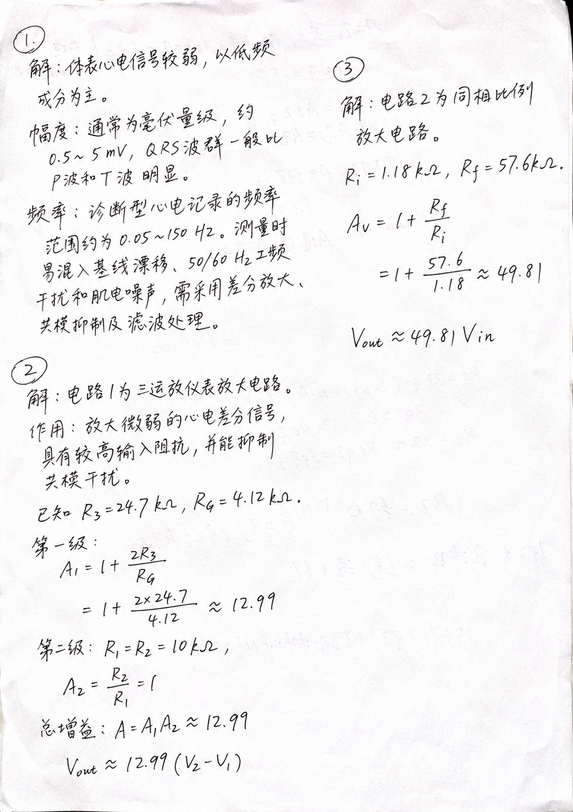
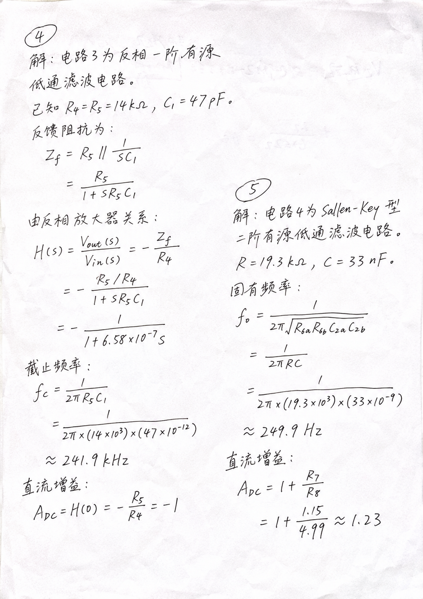

# AI Handwriting Skill

**AI作业代写 · 模仿真实字迹 · 应对手写作业**

把电子版答案、抄写内容和实验报告文字，转换成接近日常快写笔迹的手写页面，再导出带纸张阴影、透字和扫描质感的 PDF。

重点是普通人平时写作业的样子：字有大有小，行有高有低，排版有疏有密。支持参考自己的手写样张，调整连笔、行距、字形和纸面风格。

## 效果演示

下面两张图片是 AI 生成效果演示。

<p>
  
  
</p>

## 这个 Skill 做什么

- **电子文档转手写**：读取 PDF、Word、Markdown 或纯文本，按要求保留全文、仅答案或指定段落。
- **参考真实字迹**：从用户提供的样张中学习粗细、连笔、倾斜、间距与书写节奏，生成接近的整体风格。
- **自然快写**：行首错开、基线起伏、字形略变、局部挤压；可以按要求加入少量重描、划改等书写痕迹。
- **公式与计算过程**：保留分式、根号、上下标、单位和最终数值，逐页核对后交付。
- **纸张与扫描质感**：淡透字、局部明暗、纸边阴影、轻微透视与扫描颗粒。
- **多页 PDF**：按内容分块、分页，保持同一套字迹和纸面风格。

本仓库提供 **Skill 指令、生成提示词、实践经验和 PDF 合并脚本**。页面由宿主的图像生成工具完成；这里没有独立的手写模型，也不是离线字体转换器。

## 下载与安装

### 一句话让 Codex 安装

把这句话发给 Codex：

```text
请使用 $skill-installer 安装 https://github.com/yuan-fd/ai-handwriting-skill 仓库根目录的 Skill，安装名为 ai-handwriting-skill；保留 references、assets 和 scripts，并检查当前是否有支持参考图的图像生成功能。
```


### 手动安装

默认 Codex 目录：

```bash
git clone https://github.com/yuan-fd/ai-handwriting-skill.git ~/.codex/skills/ai-handwriting-skill
```

也可以[下载 ZIP](https://github.com/yuan-fd/ai-handwriting-skill/archive/refs/heads/main.zip)，解压后将目录命名为 `ai-handwriting-skill`，放入你的 Agent 的 skills 目录。仓库根目录就是 Skill，入口为 [SKILL.md](SKILL.md)。

## 怎么使用

准备待转换内容；如果希望接近自己的字迹，再附上几页自己的手写样张。直接说明要保留什么、输出什么格式。

**只转换答案：**

```text
使用 $ai-handwriting-skill。前两份是我的手写参考，第三份是要转换的解答。
只保留题号、必要答题过程、公式和结果，不要题目和额外讨论。
字不要太工整，行首和行距不要对齐，保留自然连笔、字形变化、纸张阴影和扫描质感。
最后给我一个多页 PDF。
```

**已有文字，没有参考字迹：**

```text
使用 $ai-handwriting-skill，把这份文字做成普通大学生日常快写的手写页。
参考仓库里的效果图，但只写我提供的内容。使用黑色中性笔、白纸，允许少量自然重描，导出 PDF。
```

**继续调整：**

```text
这版仍然太工整。重新参考原始手写样张生成，增加自然连笔、大小变化和行内起伏。
每行起点错开，公式不要等号对齐，版面更像随手做题；保持数字、符号和单位正确。
```

### 运行条件

需要能读取 Skill、查看参考图并调用图像生成工具的 Agent。本项目在 Codex 内置 `image_gen` 工作流中验证过；其他宿主需要提供同类能力。图像生成的可用性与费用取决于宿主和服务，本仓库不要求把 API Key 写入 Skill。

只合并已生成页面时，使用 Python 3.10+：

```bash
python -m pip install -r requirements.txt
python scripts/images_to_pdf.py page-01.png page-02.png -o homework.pdf
```

输入顺序就是页序。脚本保持图片比例，居中放入 A4 页面；它只合并页面，不生成字迹。

## 怎样做得更像日常手写

| 常见问题 | 有效做法 |
| --- | --- |
| 换了字体，仍像电脑排版 | 同时改变字形、书写节奏、行向和内容布局 |
| 每行一样齐，像认真誊抄 | 行首错开，基线起伏，行距与留白不固定 |
| 每个字都随机歪，显得刻意 | 一行有整体走势，局部再变化大小、倾斜与间距 |
| 在整齐版本上反复要求“潦草一点” | 回到原始手写参考重新生成，避免被整齐版本锚定 |
| 纸面太白太干净 | 淡透字、纸边阴影、非均匀照明和轻微透视一起处理 |
| 用涂改掩盖错误 | 先保证正确内容清楚，再少量重描或划改；不能涂掉负号、指数和单位 |

流程见 [SKILL.md](SKILL.md)，可复用的完整指令见 [生成提示词](references/prompt-template.md)，实际迭代记录见 [经验记录](references/lessons.md)。

## 目录

```text
ai-handwriting-skill/
├── SKILL.md
├── README.md
├── references/
│   ├── prompt-template.md
│   └── lessons.md
├── assets/
│   ├── demo-01.png
│   └── demo-02.png
├── scripts/
│   ├── images_to_pdf.py
│   └── check_export.py
├── requirements.txt
└── LICENSE
```

## 反馈与贡献

欢迎通过 [Issues](https://github.com/yuan-fd/ai-handwriting-skill/issues) 反馈效果问题，或提交改进提示词、公式排版与 PDF 导出的 PR。反馈时附上输入片段、提示词和效果图。

本 Skill 侧重视觉转换，生成内容需要对照原文核查。参考自己的字迹能改善风格相似度，但不等于精确复刻完整个人字库。

## 参考与致谢

- [handwriting-web](https://github.com/14790897/handwriting-web)：文本转模拟手写的网页工具。
- [chinese-handwriting-generator](https://github.com/kinrooo/chinese-handwriting-generator)：中文手写生成 Skill，启发了字体、分页和扫描效果的分层思路。
- [Inko Skill](https://github.com/pretend1111/inko-skill)：手写页面与 PDF 的 Agent 工作流参考。

最终演示采用图像生成路线，未复制上述项目的代码、字体或示例图片。

## 许可

[MIT License](LICENSE)。
